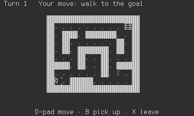

# The Playdate

What `shuyi export playdate` makes, what a game adds to run there, how to
sideload it, and what doesn't work yet. The target's numbers are its
profile's ([`targets/playdate.ron`](../../targets/playdate.ron)); the
backend is `shuyi-playdate` ([`crates/playdate`](../../crates/playdate/README.md)).
The choices behind it are
[ADR-0062](../adr/0062-the-playdate-backend-a-c-shim-a-one-bit-look-in-the-frames-look-and-a-game-library-built-as-a-static-library.md).



## What it needs

- **The Playdate SDK**, from <https://play.date/dev/>. Read Panic's license
  first: it is theirs. The Windows installer puts it in
  `Documents\PlaydateSDK`; anywhere else, set `PLAYDATE_SDK_PATH`.
- **The ARM compiler.** With MSYS2:
  `C:\msys64\usr\bin\pacman.exe -S mingw-w64-ucrt-x86_64-arm-none-eabi-toolchain`.
  On Linux: `apt-get install gcc-arm-none-eabi`.
- **The device's Rust target:** `rustup target add thumbv7em-none-eabihf`.
- **For the Simulator, on Windows:** MinGW's `gcc`
  (`pacman -S mingw-w64-x86_64-gcc`) and `rustup target add
  x86_64-pc-windows-gnu`. Without them the `.pdx` runs on the device alone,
  and the export's warnings say why. No MSVC, no nightly Rust.

## What a game adds

The device has no standard library, so the game's library builds without
`std`, and reads its data from a baked pack.

1. **A `playdate` feature** naming `shuyi-playdate`, and `shuyi` with its
   default features off, turned on by the game's own `std` feature.
2. **`shuyi_playdate::main!(start)`**, behind that feature, with `start` a
   `fn() -> Start<G>`. Its load reads `shuyi_playdate::pack()`.
3. **A one-bit look**: its `look` gives `Look::with_one_bit`.
4. **A `playdate` entry in `shuyi.ron`'s `targets`**, with a frame of at
   most 400 × 240, and a table of buttons in its keymap file. A is `East`,
   B is `West`, and `DpadUp` to `DpadRight` and `CrankForward` and
   `CrankBack` are themselves.

[`examples/hello-grid`](../../examples/hello-grid/README.md) does all of it
(`src/playdate.rs`).

The crank's notch is `crank: (notch_degrees: 45)` in the keymap file, 45
unless it says. An optional action bound to `SystemMenu0` to `SystemMenu2`
becomes an item of the system menu, titled by the text key
`system_menu.<action>`, or its name. A required action only on the crank
shows a hint while the crank is docked, by the text key `crank.unfold`.

## What the export does

```bash
cargo shuyi export playdate --release
```

It runs `check --target playdate`, bakes the pack with the game's tools,
builds the game's library as a static library for the device (and the
Simulator), links it with the backend's C shim and the SDK's `setup.c`,
writes `pdxinfo` from `shuyi.ron`'s `app` part, makes the launcher's images,
writes `NOTICES.txt`, runs the SDK's `pdc`, and reports the size against the
profile's `package_bytes`.

- **The package:** `dist/export/playdate/<game>-<version>-playdate.pdx`, and
  its zip beside it.
- **`pdxinfo`:** `name`, `author` (the publisher), `bundleID` (the id),
  `version`, `buildNumber` (the build) and, with images, `imagePath`. The
  game's data folder is named after the id, so the id never changes once a
  build is out. The SDK's license keeps "Playdate" and "Panic" out of a
  game's name.
- **The launcher's images:** `app.playdate_icon` (32 × 32) and
  `app.playdate_card` (350 × 155) as they are; otherwise `app.icon` made
  one-bit, the icon by Atkinson and the card by a threshold.
- **The pack:** `game.pack`, read whole into the heap at start. `pdc` copies
  a file it doesn't know as it is, so `game.pack` and `NOTICES.txt` are in
  the `.pdx` unchanged.
- **A debug build** drops the ELF's per-function unwind sections before
  `pdc`, which crashes on an ELF of more than 65,280 sections. Debug builds
  also run the storage conformance suite on the real files at start.

## Run it

- **Simulator:** `cargo shuyi export playdate --run` opens it and waits for
  the Simulator to close. On Windows the Simulator gives its caller nothing:
  the game's log is in its own console (the `>_` button). The arrow keys are
  the d-pad, `S` is A and `A` is B. Its speed is the computer's, never the
  device's.
- **Sideload:** at <https://play.date/account/sideload/>, upload the
  `.pdx.zip`, then install it from the device's Settings, Games. Or, plugged
  in, open it in the Simulator and choose Device, Upload Game to Device.

The export runs on a developer's machine and not in CI: the SDK's license
doesn't let it be handed on. CI builds the backend and the example's library
for the device (its `no-std` job), without linking.

## What doesn't work yet

- **No sound:** the game is silent until the audio player is shared.
- **The device's stack:** the device gives the C stack about 10 KB, and a
  game's load can go deeper. Nothing moves it to a bigger one yet, so the
  Simulator, on the computer's stack, can run what a device can't.
- **Not measured on a device:** the profile's budgets are provisional.
- **A card that is a picture** shows only its background, since the pack
  isn't read yet.
- **The engine's own screens** wear their colour look through the pattern
  map, and are cut off where they don't fit 15 rows.
- **A frame cap above 30:** the device runs at the profile's 30, whatever an
  options row says.
- **Help text** names A as `B` and B as `X` until `PadKind::Playdate`'s names
  follow the profile.
