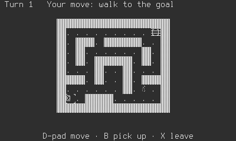

# The Playdate

What `shuyi export playdate` makes, what a game adds to run there, how to
sideload it, and what doesn't work yet. The target's numbers are its
profile's ([`targets/playdate.ron`](../../targets/playdate.ron)); the
backend is `shuyi-playdate` ([`crates/playdate`](../../crates/playdate/README.md)).
The choices behind it are
[ADR-0062](../adr/0062-the-playdate-backend-a-c-shim-a-one-bit-look-in-the-frames-look-and-a-game-library-built-as-a-static-library.md).



## What it needs

- **The Playdate SDK**, from <https://play.date/dev/>. Read Panic's license
  first: it is theirs. The Windows installer puts it in
  `Documents\PlaydateSDK`; anywhere else, set `PLAYDATE_SDK_PATH`.
- **The ARM compiler.** With MSYS2:
  `C:\msys64\usr\bin\pacman.exe -S mingw-w64-ucrt-x86_64-arm-none-eabi-toolchain`.
  On Linux: `apt-get install gcc-arm-none-eabi`.
- **The device's Rust target:** `rustup target add thumbv7em-none-eabihf`.
- **For the Simulator, on Windows:** MinGW's `gcc`
  (`pacman -S mingw-w64-x86_64-gcc`) and `rustup target add
  x86_64-pc-windows-gnu`. Without them the `.pdx` runs on the device alone,
  and the export's warnings say why. No MSVC, no nightly Rust.

## What a game adds

The device has no standard library, so the game's library builds without
`std`, and reads its data from a baked pack.

1. **A `playdate` feature** naming `shuyi-playdate`, and `shuyi` with its
   default features off, turned on by the game's own `std` feature.
2. **`shuyi_playdate::main!(start)`**, behind that feature, with `start` a
   `fn() -> Start<G>`. Its load reads `shuyi_playdate::pack()`.
3. **A one-bit look**: its `look` gives `Look::with_one_bit`.
4. **A `playdate` entry in `shuyi.ron`'s `targets`**, with a frame of at
   most 400 × 240, and a table of buttons in its keymap file. A is `East`,
   B is `West`, and `DpadUp` to `DpadRight` and `CrankForward` and
   `CrankBack` are themselves.
5. **Its sound:** its tools' `GameTools::audio` says what it ships there.
   Without it the export warns, and the game is silent.
6. **A load in steps, if its load is long.** The system ends a game whose
   update callback hasn't returned in 10 seconds, and the device loads
   data hundreds of times slower than the Simulator. A game whose load
   could pass that starts with `Start::in_steps`: its steps run a second's
   worth a callback (the profile's `load_slice_ms`), the card on the
   screen
   ([ADR-0097](../adr/0097-a-load-in-steps-a-slice-a-frame-from-the-platform-and-the-one-shot-load-kept-beside-it.md)).
   A step is the unit: one that alone takes 10 seconds still stalls, so
   make each a file or a part of a check. The run report's `Start, ms per
   update callback` line says how long each callback took.

[`examples/hello-grid`](../../examples/hello-grid/README.md) does all of it
(`src/playdate.rs`).

The export builds the `game` part's package. A game whose Playdate library is
a package of its own, beside its desktop program and its tools, names it in
the `export` part's `targets`, with the features its build turns on:

```ron
export: (
    package: "jumper-app",
    targets: {
        "playdate": (package: "jumper-playdate", features: ["demo"]),
    },
),
```

The build turns on `playdate`, then those features (none without a list:
the Playdate takes nothing else of the `export` part). `--without <feature>`
leaves one of them off, and `--with <feature>` turns on another the package
has for one build, a measuring build say: `shuyi export playdate --with
bench`. `check --target playdate` and `bake` still run the game's tools.

`--edition <name>` builds one of `shuyi.ron`'s `editions` instead: its
package and features, and its pack from its `content` folder. The game's tool
program is built again with that folder as `SHUYI_CONTENT` (in the Cargo
profile `shuyi-content`, beside the one running the export) and bakes the
pack, so the pack holds what the edition's program would embed and none of
`files/` the folder lacks ([ADR-0101](../adr/0101-an-editions-pack-is-baked-by-the-game-s-tool-program-built-with-its-content-root.md)).
`cargo shuyi bake --target playdate --content <folder>` bakes the same pack
by hand. The first such export builds every dependency of the tool program
once more. The same program bakes the sounds and music (`bake --audio`), so
they too are the folder's: a sound of `files/` the folder lacks isn't in the
`.pdx` ([ADR-0102](../adr/0102-bake-writes-a-targets-sounds-and-music-too-so-an-editions-come-from-its-content-root.md)).
Music the game's tools read from the project's own `music/` folder, not
through their files, is that folder's in every edition.
An edition with `default_features: true` is refused here (the library never
keeps them).

The crank's notch is `crank: (notch_degrees: 45)` in the keymap file, 45
unless it says. An optional action bound to `SystemMenu0` to `SystemMenu2`
becomes an item of the system menu, titled by the text key
`system_menu.<action>`, or its name. A required action only on the crank
shows a hint while the crank is docked, by the text key `crank.unfold`.

## The game's stack

The device gives the C stack about 10 KB, and a game's load or search can go
deeper: a first device build of Visions of Shuyi crashed while loading, and the
same code used 15,256 bytes on a bigger stack. So on the device every call from
the SDK into the game runs on a stack of its own from the heap, 64 KB unless
the game says. The Simulator stays on the computer's stack, so it can run what
a device can't.

`shuyi_playdate::stack_high_water()` says how many bytes of it the game has
ever used, and `None` on the Simulator. To pick a size, log it after the
game's deepest moment on a device (the load, the longest search), and allow
about four times that. Each byte is a byte less of the heap, so ask for no
more than that:

```rust,ignore
shuyi_playdate::main!(start, stack_bytes = 128 * 1024);
```

A game that reaches the stack's last 256 bytes stops with a panic that says so
as soon as its call into the game comes back, before what it overwrote can do
harm later.

## The run report

A game can say in the console, on every run, how its start went and how fast
it runs, so a tester's log shows a slow start or a stutter without a special
build. It is off unless the game's `main!` turns it on:

```rust,ignore
shuyi_playdate::main!(start, report = shuyi_playdate::RunReport::new());
shuyi_playdate::main!(start, stack_bytes = 128 * 1024, report = shuyi_playdate::RunReport::new());
```

Its lines are the log's, at level `info` in the category `platform`. Once, at
the start:

```text
Loading card shown 180 ms after start
Game data loaded in 2,150 ms
Start, ms per update callback: 1,000 (12 steps), 1,000 (40 steps), 120 (3 steps)
Game stack used: 15,256 of 65,536 bytes
Bundle: 212 reads of 180 files, 1 not in the bundle
Not in the bundle: lang/fr/ui.ron
Slowest reads, ms to the next read: maps/lake.map 900, (the rules) 310, ...
First frame of the game shown 2,400 ms after start
```

The callbacks line gives each update callback that ran the load, its time and
the load's steps it ran: one callback of one step for a load at once. A file's
time runs from its read to the next read: reading it, then parsing and
checking what it holds, and the time between two callbacks is
`(between update callbacks)`. A step of the load that reads no file can have a
name of its own, so its time isn't added to the last file's:

```rust,ignore
shuyi_playdate::report::mark("the rules");
```

Then every minute:

```text
On lake for 60 seconds: 29.8 frames a second
App::frame: min 4.1 / avg 9.6 / max 31.2 ms, 1,788 times
Draw and flush: min 1.0 / avg 3.4 / max 12.0 ms, 402 times
Game stack used: 15,256 of 65,536 bytes
Music: theme, no file player ran out of data
```

`Draw and flush` counts only the frames whose picture changed. The stack line
says `measured on the device only` on the Simulator. A file player that ran out
of data is music that stuttered: the reads from storage fell behind.

`RunReport` takes these, each optional:

- `.file("run-report.txt")` writes the start's lines and every read, with its
  time, to that file in the game's data folder once the first frame is shown:
  the Simulator has no console to read (`Disk/Data/<bundle ID>/`);
- `.every_seconds(10)` logs the running lines more often;
- `.slowest(20)` names more of the slowest reads;
- `.phases(true)`, for a measuring build, adds a line with each phase of the
  draw (the ground, the backdrop, the glyphs and so on), its average and most.
  The backend then draws every changed frame whole instead of only where it
  changed, which costs time of its own.

The report times reads with the bundle's watcher
(`shuyi_assets::bundle::watch`), which only one thing can set: if the game set
one first, the report says so and goes on without the reads. Turned on, it
reads the SDK's timer twice a frame and keeps a few numbers; the reads and the
file cost only during the load.

## Sound


Sounds and music play as they do on the PC, through the same player. The
export bakes each file the game's `GameTools::audio` names, OGG Vorbis or WAV at
44,100 Hz, to mono IMA ADPCM, about 22 KB a second:

- **sounds** are in memory all the game, in `audio/` in the `.pdx`, and eight
  play at once: a ninth stops one of them, each in turn;
- **music** streams from `music/`, each track on a file player of its own, so
  a crossfade has two.

To save room, leave a music cue out of what `GameTools::audio` answers: it isn't
baked, and it plays as silence with a warning in the console. The player's
pause, its hold on the lock and the system menu, and each handle stopping alone
are the SDK's real pause and players, so a held track goes on from where it was.

## What the export does

```bash
cargo shuyi export playdate --release
```

It runs `check --target playdate`, bakes the pack with the game's tools,
builds the game's library as a static library for the device (and the
Simulator), links it with the backend's C shim and the SDK's `setup.c`,
writes `pdxinfo` from `shuyi.ron`'s `app` part, makes the launcher's images,
writes `NOTICES.txt`, runs the SDK's `pdc`, and reports the size against the
profile's `package_bytes`.

- **The package:** `dist/export/playdate/<game>-<version>-playdate.pdx`, and
  its zip beside it.
- **`pdxinfo`:** `name`, `author` (the publisher), `bundleID` (the id),
  `version`, `buildNumber` (the build) and, with images, `imagePath`. The
  game's data folder is named after the id, so the id never changes once a
  build is out. The SDK's license keeps "Playdate" and "Panic" out of a
  game's name.
- **The launcher's images:** `app.playdate_icon` (32 × 32) and
  `app.playdate_card` (350 × 155) as they are; otherwise `app.icon` made
  one-bit, the icon by Atkinson and the card by a threshold.
- **The pack:** `game.pack`, read whole into the heap at start. `pdc` copies
  a file it doesn't know as it is, so `game.pack` and `NOTICES.txt` are in
  the `.pdx` unchanged.
- **A debug build** drops the ELF's per-function unwind sections before
  `pdc`, which crashes on an ELF of more than 65,280 sections. Debug builds
  also run the storage conformance suite on the real files at start.
- **The audio:** baked into `audio/` and `music/`, and `pdc` makes each a
  `.pda`. A file baked once is kept in Cargo's target folder, by what it holds,
  so a long track is decoded once.
- **The report:** `exposure-report.json` beside the package lists what it holds
  (the book's [Targets and
  export](../../site/content/learn/book/targets-and-export.md)). `pdc` compresses
  `pdex.bin`, so canaries are looked for in the `pdex.elf` it is made from, listed
  as a build input. `pdc` writes the time it ran into `pdxinfo` as `buildtime`,
  so the report's hash of that file leaves the line out, and the zip's size and
  hash are of its files; both say so.

## Run it

- **Simulator:** `cargo shuyi export playdate --run` opens it and waits for
  the Simulator to close. On Windows the Simulator gives its caller nothing:
  the game's log is in its own console (the `>_` button). The arrow keys are
  the d-pad, `S` is A and `A` is B. Its speed is the computer's, never the
  device's. Its volume slider, beside the screen, starts at mute.
- **Sideload:** at <https://play.date/account/sideload/>, upload the
  `.pdx.zip`, then install it from the device's Settings, Games. Or, plugged
  in, open it in the Simulator and choose Device, Upload Game to Device.

The export runs on a developer's machine and not in CI: the SDK's license
doesn't let it be handed on. CI builds the backend and the example's library
for the device (its `no-std` job), without linking.

## Budgets

Its row of ADR-0008 §6's table; *prov.* marks a starting guess. What the
budgets are and how `shuyi bench` checks them is in
[`README.md`](README.md).

| Target | Frame time on device | `frame_instructions` | `peak_heap_bytes` | `package_bytes` | `startup_ms` | Also |
| ------ | -------------------- | -------------------- | ----------------- | --------------- | ------------ | ---- |
| `playdate` | 30 fps held: p99 ≤ 33.3 ms, no frame over 50 ms, on Rev A and Rev B | 2 M (prov.: half of 168 MHz ÷ 30, leaving the rest to the SDK, the display and audio) | 10 MB (prov., of 16) | 40 MB (prov.) | 5 000 | while a bot thinks, frames still hold 30 fps; each enemy decision ≤ 1 s; only changed rows are sent to the display |

Not yet measured on a device: ticket 3011 measures it.

## Hello, Grid's numbers

From CI's `bench` job on 2026-11-05 (ticket 3008's pull request): the
heaviest of Hello, Grid's eight scenarios
([`examples/hello-grid/bench/`](../../examples/hello-grid/bench/)), on an
x86-64 Linux runner. They are proxies, not a device's frame times, and
the budgets above stay as they are until a device is measured.

| Measure | Hello, Grid | Budget |
| ------- | ----------- | ------ |
| Instructions in its heaviest frame, converted to one bit | 907,519 (`dialogue`, frame 71) | 2,000,000 |
| Heap's peak | 137.9 KB (`idle-map-tiles`) | 10 MB |
| Package | not measured: CI has no Playdate SDK | 40 MB |

## What doesn't work yet

- **Voice clips** aren't baked: a voice plays as silence, with a warning.
- **Not measured on a device:** the profile's budgets are provisional.
- **A card that is a picture** shows only its background, since the pack
  isn't read yet.
- **The engine's own screens** wear their colour look through the pattern
  map, and are cut off where they don't fit 15 rows.
- **A frame cap above 30:** the device runs at the profile's 30, whatever an
  options row says.
