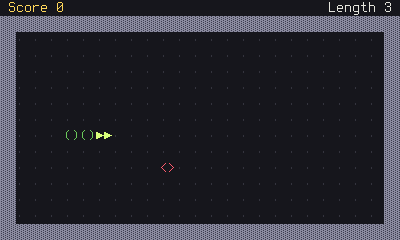

# Snake

Shuyi Engine's grid game in real time
([ADR-0148](../../docs/adr/0148-a-grid-stage-may-run-in-real-time.md)), on
the short path (`shuyi::prelude`, `BasicGame` and `run_game`). The snake
moves one tile each time its timer fires, 7.5 tiles a second at first; the
arrow keys turn it, two quick presses both count, and a turn back into its
neck is ignored. It grows by one when it eats the food and scores a point,
and every five points it moves a step sooner. A wall or its own body ends
the run. A title, the board, a pause menu (Cancel) and a screen that says
how the run ended (Confirm plays again).



```
cargo run -p snake                   # from the repository's root
cargo shuyi run --watch              # from here: a number saved in files/tuning.ron shows
cargo shuyi web --release            # from this folder: the page in dist/web/
cargo test -p snake                  # the tests
```

Its own code is 908 lines without its tests and data (`cargo xtask
template-lines examples/snake`).

## Real time on a grid

The rules (`src/rules.rs`) are a `TickSim`: 60 fixed steps a second, each
given what the player pressed in it (a `TickInput`), and timed in steps
with `Every`, never with a frame's `dt`. The stage (`src/screens.rs`) steps
them once for each of the frame's steps through the engine's `TickDriver`,
which records every step's input in a `TickRecord`. So the snake moves the
same at 30 and at 60 frames a second, and a record replays the same on
every machine (`cargo shuyi replay`, through `replay::ticks`). It is drawn
as a turn game's grid is: a `MapScene` of the board, the snake and the
food, painted by the grid kit's glyph skin.

## Layout

| Path | What |
| ---- | ---- |
| `src/rules.rs`, `src/rules/tests.rs` | The rules, pure (no I/O, no clock, no float): the board, the snake, its turns, the food from the seeded RNG kept in the state, and the run's numbers (`Tuning`) |
| `src/screens.rs` | The title, the board and its line of score and length, the pause menu, the end of a run; the board's scene and its look |
| `src/lib.rs` | The game on the short path: its files, its own part (the board and the numbers) and its 50 × 15 console |
| `src/tools.rs`, `examples/tools.rs` | Its tools (`frame-png`, `lang-status`, and the tool contract's `check`, `run`, `scene`, `replay`), its look on a one-bit screen, and the tool program `shuyi` runs them in |
| `src/main.rs` | The binary (the default `window` feature) |
| `files/` | Embedded: the board (`.map`), the run's numbers (`tuning.ron`), the keymap, the palette and its one-bit patterns, the English text, the two sounds (`.sfx.ron`) and the font atlas |
| `shuyi.ron` | The project file of the engine's tools |
| `long/` | A long run, `cargo shuyi bench --long`: runs lost and started again for a million frames, its heap and sounds kept flat |
| `tests/golden.rs`, `tests/golden/`, `tests/records/` | The golden table: the playthrough's record's hash at every step and its outcome. It builds without the window (`--no-default-features`), so it runs under wasmtime too |
| `tests/it/` | The playthrough through actions only, 30 and 60 frames a second, the pause menu, the tool contract and the replay of the playthrough's record, the rules under random input, and pictures as snapshots |

## Its tools

From this folder, each with `--json` for an answer a program reads
([`docs/contract.md`](../../docs/contract.md)):

```
cargo shuyi check                                  # every error in files/
cargo shuyi check --target all                     # it fits each target shuyi.ron lists
cargo shuyi run --script "Enter Down" --frames 120
cargo shuyi scene --script "Enter" --frames 60     # the board and the run: length, score, over
cargo shuyi replay tests/records/seed-1.ron        # a run's record, step by step
cargo shuyi frame-png --preview                    # preview.png, from shuyi.ron's `preview`
```

A tick game has no bots yet, so no `playtest`.

## Targets

`shuyi.ron` lists the desktop, the web, the Steam Deck and the Playdate,
and `cargo shuyi check --target all` passes on each. Its console is 50 ×
15 cells, 400 × 240, the Playdate's screen: the board's 25 × 14 tiles,
two cells each, under the score line. `files/keymap.ron` has a table of
buttons for the Playdate (the d-pad, A and B) and one for the Deck, and
`files/palette@onebit.ron` keeps the snake apart from the food and the
floor from the walls in black and white. It doesn't build for the
Playdate yet: the short path has no one-bit look and reads no pack there
(ticket 3352).

## Art and licenses

Terminus Font 4.49.1 (the atlas in `files/font/`, copied from Hello,
Grid's) is under the SIL Open Font License 1.1:
`files/font/Terminus-LICENSE.txt`. Everything else here is the engine's
own: the sounds are the engine's presets `coin` and `explosion`.
